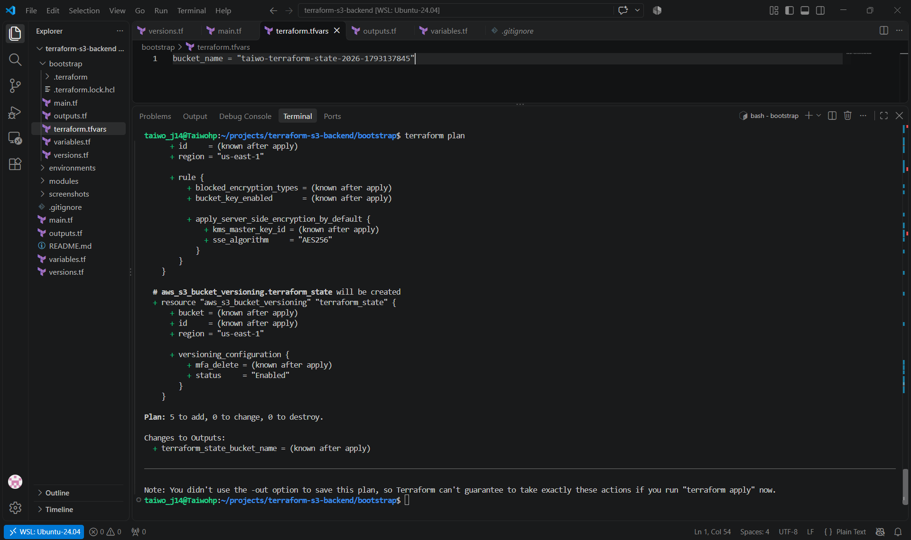
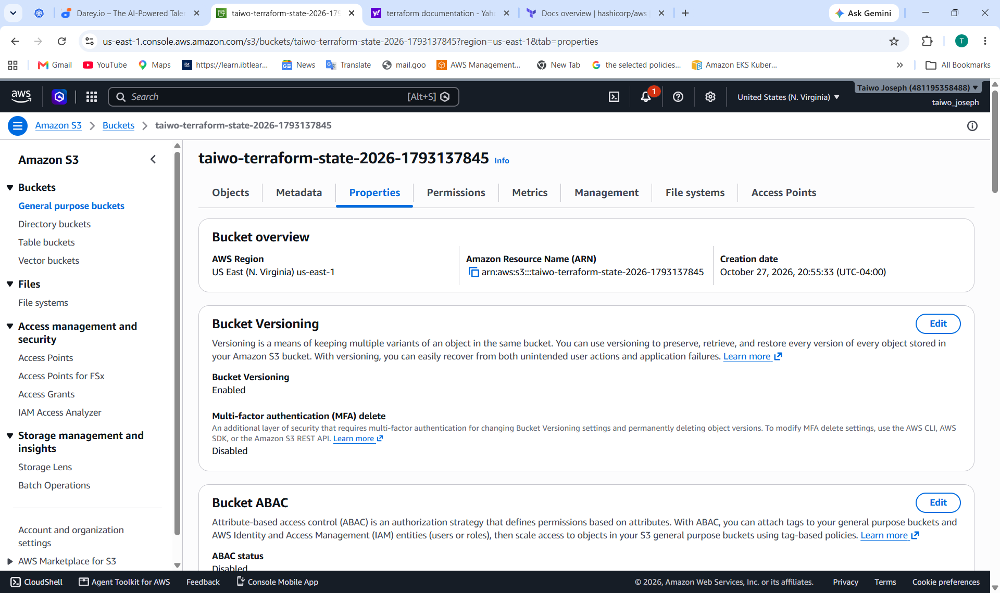
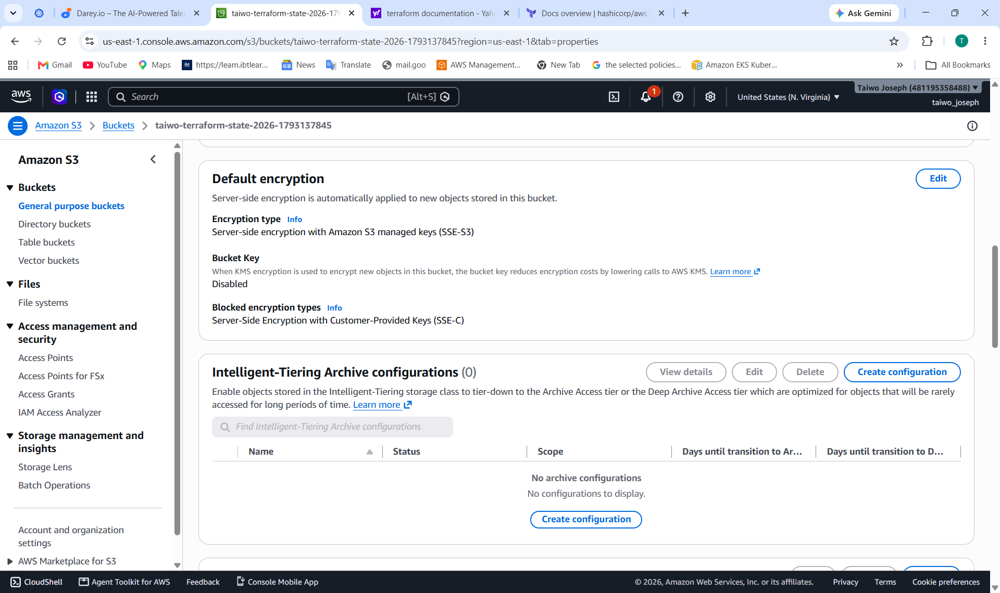
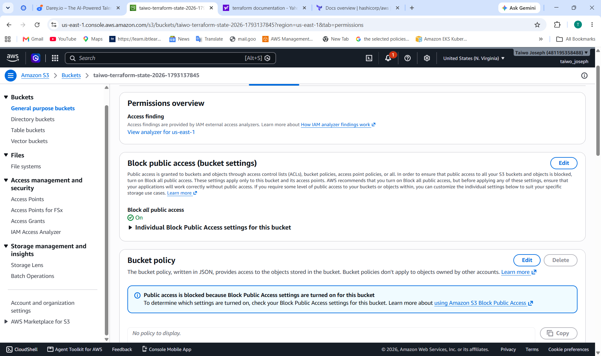
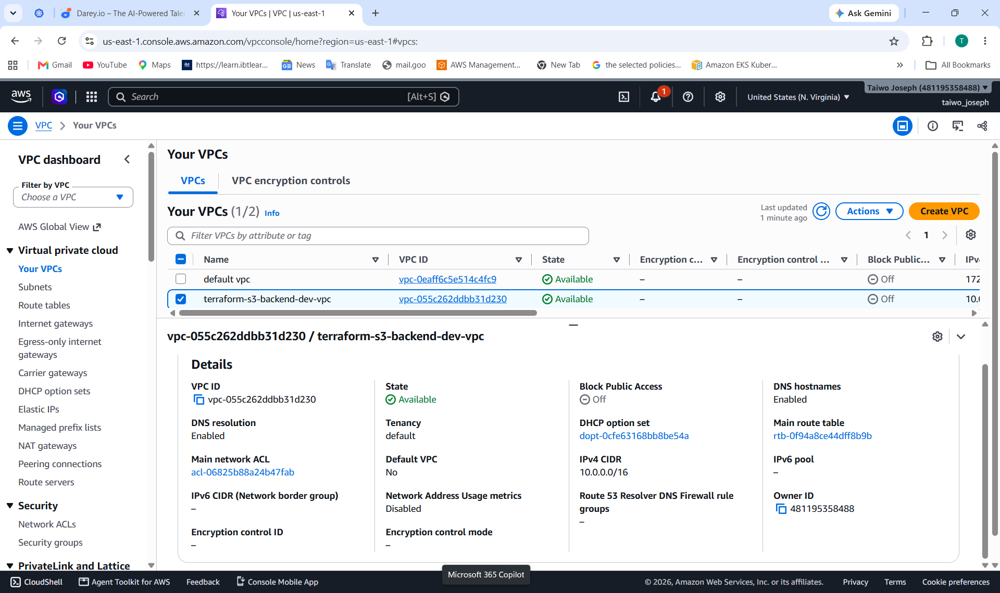
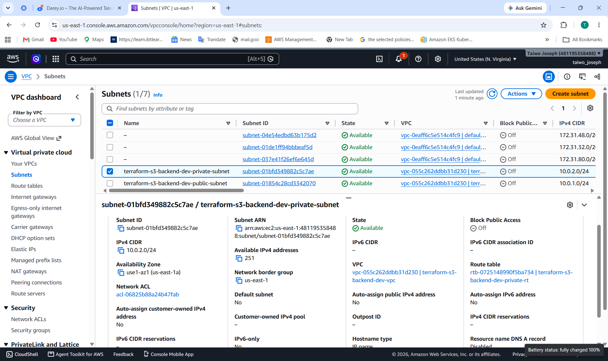
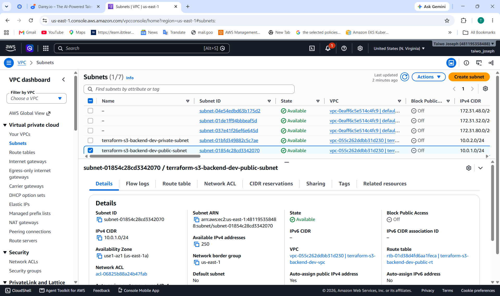
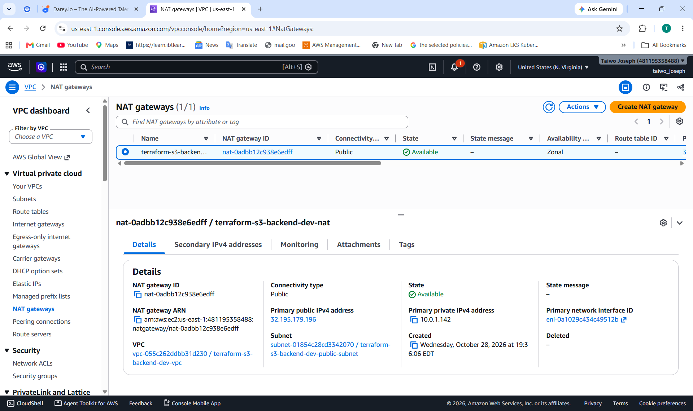
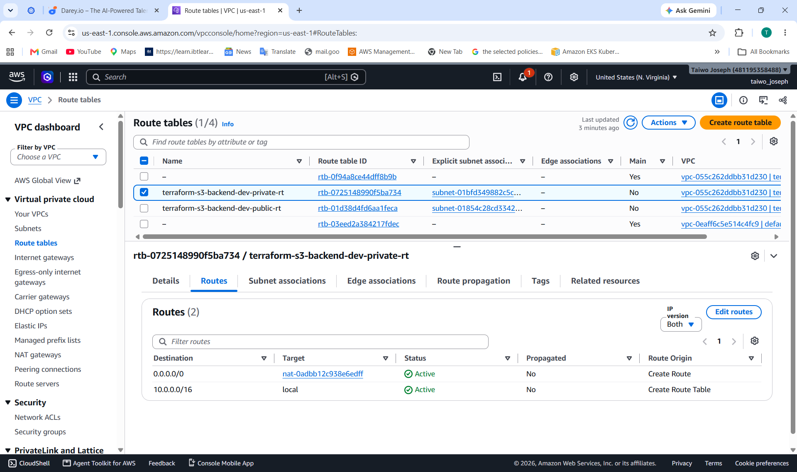

# Terraform AWS VPC Infrastructure with Secure S3 Remote State

## Project Overview

This project demonstrates how to use **Terraform Infrastructure as Code (IaC)** to provision AWS networking resources and manage Terraform state remotely in Amazon S3.

The project follows a two-stage workflow:

1. **Bootstrap:** Create and secure an Amazon S3 bucket for Terraform remote state.
2. **Infrastructure deployment:** Use Terraform to provision an AWS Virtual Private Cloud (VPC), public and private subnets, routing, and a NAT Gateway.

The goal is to demonstrate practical cloud engineering skills, including infrastructure automation, network design, remote state management, security best practices, resource verification, and cost-conscious cleanup.

**AWS Region:** `us-east-1` (US East — N. Virginia)

**Infrastructure tool:** Terraform

**Cloud provider:** Amazon Web Services (AWS)

**Repository:** [taiwoj14/terraform-s3-backend](https://github.com/taiwoj14/terraform-s3-backend)

---

## Project Objectives

- Provision AWS networking infrastructure using Terraform.
- Configure a VPC with public and private subnets.
- Configure an Internet Gateway and route tables.
- Provide outbound internet access for private-subnet resources through a NAT Gateway.
- Store Terraform state remotely in Amazon S3.
- Enable S3 bucket versioning and server-side encryption.
- Block public access to the Terraform state bucket.
- Use Git and GitHub for version control.
- Verify deployed resources using the AWS Management Console.
- Practice infrastructure cleanup to reduce unnecessary AWS charges.

---

## Architecture

The infrastructure was designed with the following network layout:

```text
                    AWS Cloud
                       |
                 Amazon VPC
                 10.0.0.0/16
                       |
          +------------+------------+
          |                         |
     Public Subnet             Private Subnet
     10.0.1.0/24               10.0.2.0/24
          |                         |
     Internet Gateway          NAT Gateway
          |                         |
      Internet              Outbound Internet
                                Access

        Terraform State
               |
          Amazon S3
       Remote State Bucket
```

### Network Components

| Component | Configuration | Purpose |
|---|---|---|
| VPC | `10.0.0.0/16` | Provides an isolated AWS network |
| Public subnet | `10.0.1.0/24` | Provides a subnet for resources that require public network connectivity |
| Private subnet | `10.0.2.0/24` | Provides a subnet for resources that should not be directly exposed to the internet |
| Internet Gateway | Attached to the VPC | Enables internet routing for the public subnet |
| Public route table | Default route through the Internet Gateway | Routes eligible public-subnet traffic to the internet |
| NAT Gateway | Deployed in the public subnet | Allows private-subnet resources to initiate outbound internet connections |
| Private route table | Default route through the NAT Gateway | Routes private-subnet internet-bound traffic through the NAT Gateway |
| Amazon S3 | Remote Terraform state | Stores Terraform's infrastructure state remotely |

**Important:** A private subnet and NAT Gateway do not, by themselves, guarantee complete security. Production deployments should also implement suitable security groups, network ACLs, IAM permissions, and other required controls.

---

## Technologies Used

- **Amazon VPC** — virtual networking
- **Amazon EC2 networking components** — NAT Gateway and Elastic IP
- **Amazon S3** — remote Terraform state storage
- **Terraform** — infrastructure provisioning and lifecycle management
- **AWS Provider for Terraform** — AWS resource integration
- **AWS CLI** — authentication and resource verification
- **Git** — source control
- **GitHub** — project hosting and documentation
- **VS Code and Ubuntu on WSL2** — development environment

---

## Repository Structure

```text
terraform-s3-backend/
├── bootstrap/
│   ├── main.tf
│   ├── outputs.tf
│   ├── variables.tf
│   ├── versions.tf
│   └── .terraform.lock.hcl
├── screenshots/
│   ├── 01-terraform-plan.png
│   ├── 02-s3-versioning.png
│   ├── 03-s3-encryption.png
│   ├── 04-s3-public-access.png
│   ├── 05-vpc-details.png
│   ├── 06-private-subnet-details.png
│   ├── 07-public-subnet-details.png
│   ├── 08-nat-gateway-details.png
│   ├── 09-private-rt-details.png
│   └── 10-public-rt-details.png
├── main.tf
├── variables.tf
├── outputs.tf
├── versions.tf
├── .terraform.lock.hcl
├── .gitignore
└── README.md
```

The `bootstrap/` directory contains the Terraform configuration for creating the S3 state bucket. The root Terraform configuration manages the VPC and networking resources.

The `screenshots/` directory contains evidence captured during the deployment.

---

## How Terraform Remote State Works

Terraform state records information about the infrastructure Terraform manages. Remote state allows Terraform to store this information in a shared, durable location rather than relying only on a local state file.

This project uses an Amazon S3 bucket as its remote state backend.

The root Terraform configuration uses:

- **Backend:** Amazon S3
- **Region:** `us-east-1`
- **State key:** `environments/dev/terraform.tfstate`
- **Encryption:** Enabled
- **S3 lockfile:** Enabled through `use_lockfile = true`

The bootstrap configuration uses a separate state key:

`bootstrap/terraform.tfstate`

Keeping the bootstrap state separate from the root infrastructure state helps Terraform manage the state bucket independently of the infrastructure that depends on it.

### S3 Security Controls

The state bucket was configured with the following protections:

- **Versioning enabled:** Helps recover earlier versions of state objects.
- **Server-side encryption:** Uses Amazon S3-managed encryption keys (SSE-S3/AES-256).
- **Block Public Access:** All four public-access-block settings are enabled.
- **Bucket ownership controls:** Bucket owner enforced.
- **Remote state storage:** Keeps the root Terraform state in S3.

Terraform state can contain sensitive infrastructure information. A secure bucket configuration does not replace the need for restrictive IAM permissions and careful handling of state files.

---

## Prerequisites

Before deploying this project, make sure you have:

1. An AWS account.
2. Terraform installed.
3. AWS CLI installed and configured.
4. Valid AWS credentials with the permissions required to create the relevant S3 and VPC resources.
5. Git installed.
6. Access to the project repository.

Verify your tools:

```bash
terraform -version
aws --version
git --version
```

Verify AWS authentication:

```bash
aws sts get-caller-identity
```

Do not commit AWS access keys, secret keys, local Terraform state files, or sensitive `.tfvars` files to GitHub.

---

## Deployment Guide

### Step 1: Clone the repository

```bash
git clone https://github.com/taiwoj14/terraform-s3-backend.git
cd terraform-s3-backend
```

### Step 2: Initialize the bootstrap configuration

The S3 state bucket must exist before the root Terraform configuration can use it as a backend.

```bash
cd bootstrap
terraform init
terraform validate
terraform plan
```

Review the plan before proceeding.

### Step 3: Create the S3 state bucket

If the bootstrap resources have not already been created, apply the bootstrap configuration:

```bash
terraform apply
```

Review the proposed changes and type `yes` only after confirming the plan is correct.

**Important:** The existing state bucket is retained for this project. Do not create a second bucket unnecessarily or destroy the existing bucket while the root configuration still depends on it.

### Step 4: Initialize the root Terraform configuration

Return to the project root:

```bash
cd ..
terraform init
```

Terraform initializes the AWS provider and configures the S3 backend.

If the backend has already been initialized and its configuration has changed, review the change carefully before using backend migration or reconfiguration options.

### Step 5: Configure Terraform variables

An example variable file is provided as `terraform.tfvars.example`. Use it to customize the project name, environment, VPC CIDR, and subnet CIDR ranges.

Copy the example file to create your local variable file:

```bash
cp terraform.tfvars.example terraform.tfvars
```

Edit `terraform.tfvars` to use the values you want for your deployment. Terraform automatically loads a file named `terraform.tfvars` when running commands from the project root.

Review your configuration and proposed changes before deploying:

```bash
terraform validate
terraform plan
```

**Security note:** The local `terraform.tfvars` file is excluded from Git to help prevent accidental commits. Keep `terraform.tfvars.example` updated with safe example values, and never put AWS access keys, secret keys, or other sensitive credentials in either file.

### Step 6: Validate the configuration

```bash
terraform fmt -check
terraform validate
```

Formatting and validation help identify configuration and syntax issues before deployment.

### Step 7: Review the execution plan

```bash
terraform plan
```

Inspect the resources Terraform proposes to create, change, or destroy.

The original deployment plan proposed creating 10 networking resources.

### Step 8: Deploy the infrastructure

Only when you are ready to incur any associated AWS charges:

```bash
terraform apply
```

Review the plan and confirm it before allowing Terraform to create the resources.

### Step 9: Verify the outputs and resources

```bash
terraform output
terraform state list
```

You can also verify resources through the AWS Management Console or AWS CLI.

For example, to check the VPCs in the selected region:

```bash
aws ec2 describe-vpcs --region us-east-1
```

To check the NAT Gateways:

```bash
aws ec2 describe-nat-gateways --region us-east-1
```

These commands may return other resources in your AWS account, so identify the resources belonging to this project before drawing conclusions.

---

## Infrastructure Deployment Results

The original deployment successfully provisioned 10 networking resources.

| Resource | Result |
|---|---|
| VPC | Created and verified |
| Public subnet | Created and verified |
| Private subnet | Created and verified |
| Internet Gateway | Created and verified |
| NAT Gateway | Created and verified |
| Elastic IP | Allocated for the NAT Gateway |
| Public route table | Created and verified |
| Private route table | Created and verified |
| Public route table association | Created and verified |
| Private route table association | Created and verified |

The deployed configuration was verified using AWS console screenshots.

### Current Resource Status

After verification, I ran `terraform destroy` and confirmed that Terraform destroyed all 10 networking resources.

The S3 state bucket was retained so that the Terraform backend remains available.

**The networking resources are currently destroyed.** The screenshots below document the successful deployment before cleanup; they do not mean that the VPC and NAT Gateway are still running.

---

## AWS Infrastructure Screenshots

The following screenshots provide evidence of the Terraform plan, S3 security settings, and AWS networking resources captured during the deployment.

### 1. Terraform execution plan



*The Terraform plan showed the proposed creation of the networking resources before deployment.*

### 2. S3 bucket versioning



*Evidence of versioning configuration for the Terraform state bucket.*

### 3. S3 server-side encryption



*Evidence of server-side encryption for stored Terraform state.*

### 4. S3 Block Public Access



*Evidence that public access is blocked on the state bucket.*

### 5. VPC details



*The VPC configuration captured during the successful deployment.*

### 6. Private subnet



*The private subnet configuration.*

### 7. Public subnet



*The public subnet configuration.*

### 8. NAT Gateway



*The NAT Gateway configuration captured during deployment.*

### 9. Private route table



*The private route table used for routing outbound traffic through the NAT Gateway.*

### 10. Public route table


*The public route table configured to route internet-bound traffic through the Internet Gateway.*

---

## Cost Management and Cleanup

AWS networking resources can incur charges even when they are not actively used.

In particular, NAT Gateways generally incur hourly charges and data-processing charges. Elastic IP address charges may also apply depending on how the address is allocated and used.

To avoid unnecessary ongoing costs, I destroyed the Terraform-managed networking infrastructure after completing verification.

When you no longer need a deployment, review the proposed cleanup:

```bash
terraform plan -destroy
```

If the plan is correct and you are ready to remove the infrastructure:

```bash
terraform destroy
```

Confirm the action only after checking the resources Terraform proposes to remove.

**Do not destroy the bootstrap S3 bucket as part of ordinary networking cleanup.** It stores the remote state required by the root configuration. Destroying it without a deliberate state-migration and recovery plan could make future Terraform operations difficult.

The S3 bucket may still incur storage and request charges, so review your AWS billing dashboard periodically.

---

## Lessons Learned

Through this project, I practiced:

- Writing reusable, organized Terraform configuration files.
- Understanding the relationship between a VPC, subnets, gateways, and route tables.
- Separating public and private network routing.
- Configuring an S3 backend for remote Terraform state.
- Applying S3 versioning, encryption, and public-access protections.
- Using Terraform plans to review changes before applying them.
- Verifying deployed AWS resources through the console and CLI.
- Using Git and GitHub to version and document infrastructure code.
- Cleaning up cloud resources to control costs.

---

## Future Improvements

Potential next steps include:

- Add automated Terraform formatting and validation through GitHub Actions.
- Introduce reusable Terraform modules for networking and S3.
- Add separate development and production environment configurations.
- Implement automated security and configuration checks.
- Add a CI/CD workflow for validating infrastructure changes.
- Expand the architecture with application compute resources and CloudWatch monitoring.

---

## Author

**Taiwo Joseph**

Aspiring Junior AWS Cloud / DevOps Engineer

GitHub: [@taiwoj14](https://github.com/taiwoj14)

This project is part of my hands-on learning journey in AWS cloud infrastructure, Terraform, automation, and DevOps engineering.

---

## Disclaimer

This repository is intended for learning and demonstration purposes. Review all Terraform plans, AWS permissions, security settings, and expected charges before deploying the infrastructure in a real AWS account.
